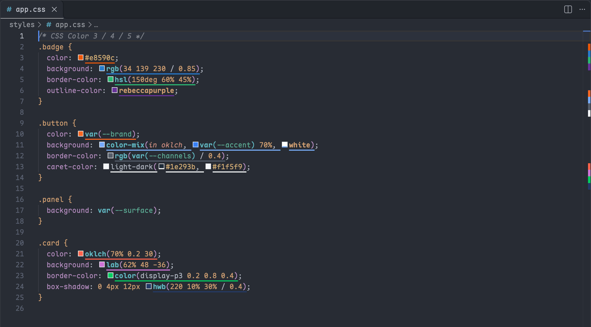
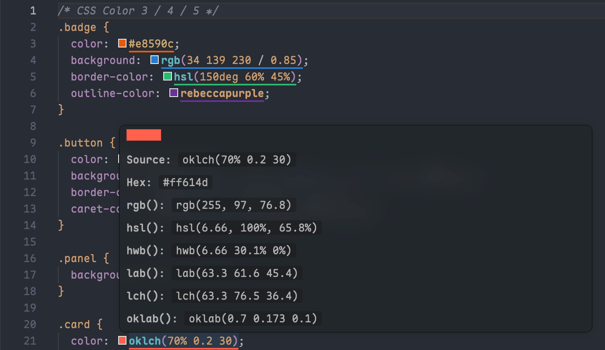
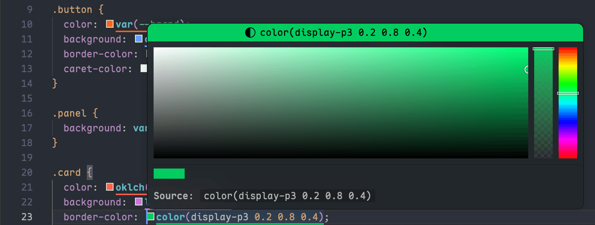
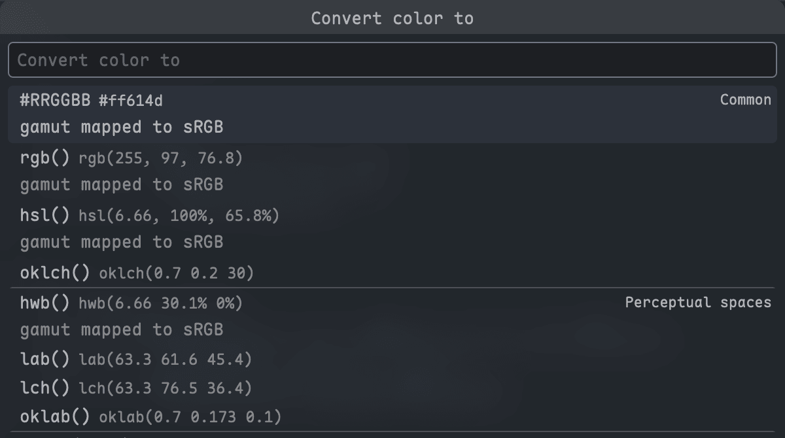
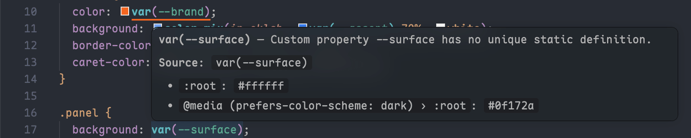

# W3C Color Toolkit

[English](../README.md) · **简体中文**

> 插件市场页只显示英文版 README；插件界面会跟随 VS Code 的显示语言切换为中文。

在任意源文件中高亮、查看、取色与转换 CSS 颜色，覆盖 hex 到 `oklch()`、`color-mix()` 与 HDR。

Color Highlight、Color Info 和 Change Color Format 三个插件分头做的事，这一个插件全包了，而且在所有语言里都认得 CSS Color 3、4、5 以及 CSS Color 6 与 HDR 两份草案。VS Code 自带的色块认得 hex、`rgb()`、`hsl()` 这类经典写法，`color(display-p3 …)`、`color-mix()`、相对颜色和 `var(--brand)` 背后的设计变量却没有色块。高亮、悬停、原生取色器和格式转换共用一套颜色内核，同一个颜色的范围、取值以及能否解析，四者的判断始终一致。

## 快速开始

从安装到转换出第一个颜色只要三步，前提是 VS Code 1.101 或更高版本。

1. 从 [VS Code 插件市场](https://marketplace.visualstudio.com/items?itemName=HeavenSky.w3c-color-toolkit)安装。
2. 打开任意含颜色的文件，把鼠标悬停在一个颜色上：会看到预览色块、原文，以及每种已启用格式下的取值。
3. 把光标放进一个颜色，在命令面板执行「W3C Color Toolkit: 转换颜色」，把它改写成另一种格式。

## 看见每一个颜色，不只是 hex 和 rgb()

每个受支持的颜色都会在编辑器里加上标记，并在概览标尺上打点，CSS 和其他语言都一样。默认标记是下划线，`w3cColorToolkit.highlight` 还提供其他样式。`currentColor`、没有定义的 `var()` 这类依赖上下文的值，绝不会画成臆测的颜色。选标记样式、定哪些语法参与高亮，见[高亮与悬停](./docs/highlight-and-hover.md)。

## 悬停查看颜色的各种格式

悬停时显示预览色块、原文、每种格式各一行，以及该语法所属的规范层级。

## 用原生取色器改色，格式不丢

点击任意受支持颜色前的色块即可打开 VS Code 取色器，`oklch()`、`lab()` 和 `color(display-p3 …)` 也不例外。**只要没有真正改动颜色，原文就保持不变**；改动后，只要原格式能表达新值，就按原格式写回。`color-mix()`、已解析的 `var()` 这类表达式只给只读色块，误拖一下也不会把表达式压成字面量。详见[用取色器改色](./docs/color-picker.md)。

## 转换颜色，不悄悄丢掉 alpha 或色域

「转换颜色」就地改写取值，「复制颜色为」把结果放进剪贴板，目标格式从 `#RRGGBB` 一直到 `color(rec2100-pq)`。写入前会提示色域映射；除非你允许，否则拒绝丢弃 alpha 或 `none` 分量。选区规则与快捷键绑定见[转换与复制颜色](./docs/convert.md)。

## 预览 var()、$ 与 @ 背后的设计变量

只要工作区里的定义唯一，`var(--brand)`、`$brand` 和 `@brand` 就会解析成它们代表的颜色，Tailwind 风格的通道变量 `rgb(var(--channels) / 0.4)` 也一样。一个变量有多处定义时（例如每个主题各一份），悬停会列出全部候选值，而不是去猜。详见[解析变量](./docs/variables.md)。

## 什么时候不适合用

它能解析变量，但不执行预处理器逻辑：SCSS map、`@each`、mixin、`darken()` 这类函数以及 Stylus 变量都不处理。它也不会把 `bg-red-500` 这类 Tailwind 工具类映射成颜色，这件事交给 Tailwind CSS IntelliSense。

## 延伸阅读

- [文档索引](./docs/README.md)：配置、支持的语法与故障排查。
- 命令与设置的完整列表见插件市场页的 Feature Contributions 标签。
- 每个版本的变化见[更新日志](./CHANGELOG.md)。

## 许可证

[MIT](../LICENSE.txt)。第三方声明见 [NOTICE.md](../NOTICE.md)。
